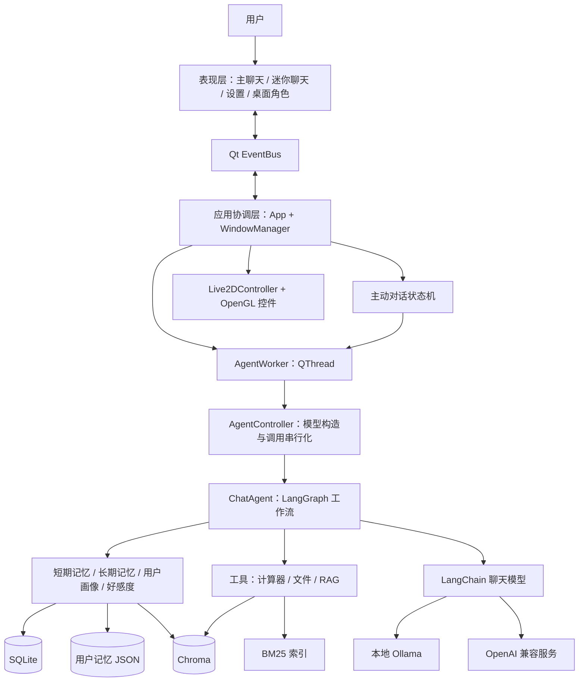
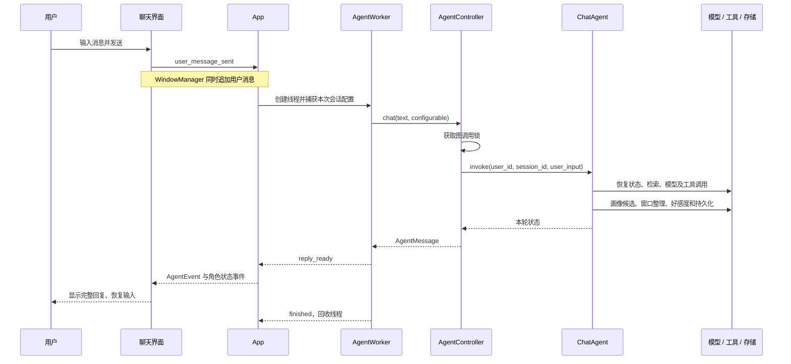
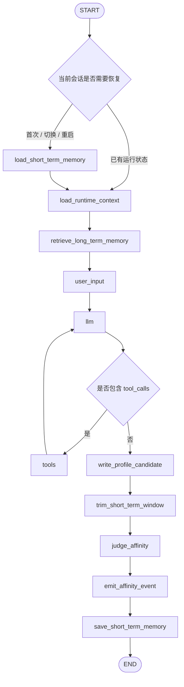
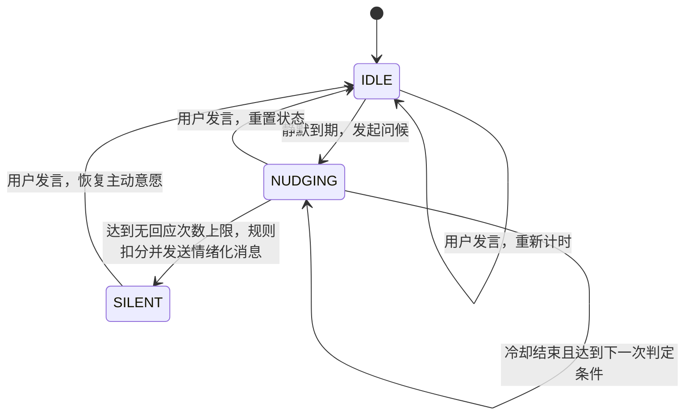

# YourLover 桌面智能助手项目报告

> 版本依据：2026 年 10 月 20 日的项目源码及开发文档。本文描述当前实际实现，并在独立章节列出限制与后续方案。面试定位以 Agent 应用开发、Python 工程和桌面应用开发为主。

## 一、项目概述

### 1.1 项目定位

YourLover 是一个具备桌面角色形象、持续对话、跨会话记忆和工具调用能力的个人智能助手。项目以 PySide6 构建桌面界面，以 Live2D 提供角色表现，以 LangGraph 编排 Agent 对话流程，支持本地 Ollama 和 OpenAI Chat Completions 兼容服务。

用户可以通过主聊天窗口进行连续交流，也可以在角色旁展开迷你聊天快速输入。系统维护会话历史、用户画像、长期记忆和好感度，并能够根据用户静默时长主动发起对话。

项目的工程重点是把模型能力组织成可交互、可持久化、可配置、可测试的桌面应用。当前属于单机个人应用架构，未采用服务端微服务或多 Agent 协作架构。

### 1.2 项目解决的问题

| 问题 | 项目中的处理方式 |
| --- | --- |
| 普通聊天应用缺少桌面陪伴感 | 透明置顶角色窗口、Live2D 动作与表情、角色旁快速聊天 |
| 重启或新建会话后丢失上下文 | SQLite 保存短期会话；画像和长期记忆跨会话召回 |
| 长对话持续增加上下文开销 | 按完整轮次裁剪消息，滚动生成会话摘要和长期记忆 |
| 模型不擅长精确计算及私有知识查询 | 通过工具调用计算器、文件读写和 RAG |
| 本地模型对硬件要求较高 | 同时提供 Ollama 和用户自定义兼容 API 接入 |
| 模型调用耗时导致界面卡顿 | QThread 执行对话，Qt 信号回传结果 |
| 模型推断可能误写用户信息 | 画像候选审核、字段白名单、来源权限和证据校验 |
| 桌面多窗口容易形成相互依赖 | 组件拆分、WindowManager 协调、EventBus 路由 |

### 1.3 典型使用场景

用户打开应用后，桌面显示角色和快速聊天入口。用户在主聊天中分享近期经历，助手结合当前会话、画像和可召回记忆生成回复；用户明确表达称呼偏好时，画像模块提取并审核候选。长对话超过窗口阈值后，系统整理早期内容，在保留原始记录的同时压缩模型上下文。

后续新建会话时，短期上下文独立，已经保存的画像和相关长期记忆仍可以参与生成。用户也可以通过设置切换模型服务，或让助手调用知识库与工具处理具体任务。

长期记忆写入主要由窗口裁剪触发，因此“刚说过一句话”并不等于“已经形成跨会话长期记忆”。同一会话内的即时连续性由短期消息保证。

## 二、需求分析与功能范围

### 2.1 已实现功能

| 模块 | 功能 | 实现边界 |
| --- | --- | --- |
| 桌面角色 | 透明悬浮、置顶、拖拽、点击区域、摇晃检测、动作与表情 | 使用已有 Live2D 资源，不包含模型制作 |
| 主聊天 | 多轮文本交流、新建/切换/删除会话、历史恢复、状态展示 | 当前展示完整文本回复，不提供流式输出 |
| 迷你聊天 | 胶囊入口、单行输入、思考提示、回复浮层、长文本滚动 | 固定独立会话 `mini-chat` |
| 模型设置 | 服务切换、地址/模型/密钥配置、校验、持久化、热加载 | 兼容服务需要支持 Chat Completions 和工具调用 |
| 短期记忆 | 会话存储、消息排序、窗口裁剪、摘要恢复 | SQLite 持久化，进程内使用 MemorySaver |
| 长期记忆 | 记忆提取、向量或关键词检索、日期上下文、规则降级 | 不保证所有历史信息都被自动提取和召回 |
| 用户画像 | 结构化字段、候选提取、自动审核、确认/拒绝服务接口、变更日志 | 尚无完整的画像候选确认界面 |
| 好感度 | 回复增量解析、分数限幅、持久化、界面展示 | 属于产品交互规则，不是心理学情感测量 |
| 主动对话 | 静默检测、随机问候节奏、冷却、生气后沉默、用户活跃重置 | 基于时间状态机，未接入系统级用户活动感知 |
| 工具 | 计算器、文件读写、知识库查询 | 没有真实联网搜索、沙箱或完整工具权限管理 |
| 知识上传 | Streamlit 页面上传文本内容、分块、向量化、去重 | 新增文档仍使用 Ollama embedding |

### 2.2 非功能目标

1. **界面响应性**：对话调用在工作线程执行，避免主聊天流程阻塞 Qt 事件循环。
2. **数据连续性**：原始会话、画像、分数和长期记忆能够跨应用启动保存。
3. **模块可替换性**：模型、记忆服务和提取器支持通过构造参数注入。
4. **失败可恢复性**：辅助模型调用或向量服务失败时，尽可能使用已有降级路径。
5. **实现可验证性**：使用替身模型、内存 HTTP transport 和离屏 Qt 测试验证关键契约。

以上是设计目标及相应机制，不代表项目已经具备经过压测的吞吐、可用性或响应时间承诺。

## 三、技术选型

| 技术 | 用途 | 选择理由与取舍 |
| --- | --- | --- |
| Python 3.12 | 应用与 Agent 主要开发语言 | 便于连接 Qt、模型 SDK、检索和数据处理；不承担 CPU 密集型模型推理 |
| PySide6 / Qt | 桌面窗口、信号、线程和计时器 | 原生桌面能力完整，适合透明窗口、多窗口与 OpenGL 控件 |
| live2d-py / OpenGL | 角色渲染及动作 | 复用 Live2D 模型表现；运行依赖图形环境与资源兼容性 |
| LangGraph | 有状态对话工作流 | 显式表达条件分支、工具循环、状态恢复及对话后处理 |
| LangChain | 统一消息、聊天模型和工具 schema | 减少服务适配工作，但仍需单独处理不同服务的参数和能力边界 |
| Ollama | 本地聊天与 embedding | 支持本地部署；效果和性能受模型与硬件影响 |
| OpenAI 兼容客户端 | 自定义聊天接口 | 用户只需配置 URL、Key、Model ID；不假定具备 embedding 服务 |
| SQLite | 会话、画像、好感度 | 单机部署简单，支持事务、索引和 WAL；不是分布式数据库方案 |
| Chroma | 知识库及长期记忆向量集合 | 适合本地语义检索，提供持久化和元数据过滤 |
| Jieba + BM25 | 中文关键词检索 | 对专有名词和精确关键词有帮助；语义泛化能力依赖分词及语料 |
| RRF | 融合两路知识库检索结果 | 用排名融合，避免直接比较 BM25 与向量分数 |
| Streamlit | 独立知识上传页面 | 便于提供管理入口；主桌面界面仍由 Qt 实现 |
| pytest / Ruff | 回归、静态检查和格式 | 将业务行为验证与代码风格约束纳入日常开发 |

## 四、整体架构设计

### 4.1 架构形态

项目采用单进程、分层模块化架构。UI 主线程负责界面，工作线程负责耗时对话；本地数据库和文件保存数据，模型服务位于本地 Ollama 或用户指定的 HTTP 接口。



### 4.2 分层职责

| 层次 | 主要模块 | 职责 |
| --- | --- | --- |
| 表现层 | `windows/`、`widgets/` | 展示、输入、快捷键、窗口布局、交互反馈 |
| 应用协调层 | `app.py`、`window_manager.py`、`event_bus.py` | 生命周期、线程、窗口导航、配置变更、事件转发 |
| Agent 层 | `agent_controller.py`、`ChatAgent.py` | 模型适配、状态图、上下文组装、工具调用和对话后处理 |
| 领域服务层 | `memory/`、`affinity/`、`proactive/`、`tools/` | 记忆规则、画像审核、好感度、主动调度、工具执行 |
| 基础设施层 | SQLite Store、Chroma、文件存储、模型 SDK | 数据持久化、检索和外部服务通信 |

这是职责划分，不意味着代码已实现严格的依赖倒置：例如 RAG 工具注册时会初始化资源，部分模块仍使用共享配置实例。可在后续通过资源工厂和显式注入进一步降低耦合。

### 4.3 目录组织

```text
YourLover/
├─ main.py                       启动入口
├─ app.py                        应用、工作线程、配置热加载
├─ core/                         事件总线与事件结构
├─ windows/                      四类顶层窗口及管理器
├─ widgets/                      聊天、设置、菜单、回复气泡、主题与图标
├─ avatar/                       Live2D 渲染与角色控制
├─ agent/
│  ├─ agent_controller.py         统一模型及对话入口
│  ├─ agent/ChatAgent.py          LangGraph 对话编排
│  ├─ models/                    Ollama / OpenAI 兼容适配
│  ├─ memory/                    记忆、画像、提取、裁剪、存储
│  ├─ affinity/                  好感度规则与存储
│  ├─ proactive/                 主动对话状态机
│  ├─ tools/                     工具基类、注册与实际工具
│  └─ rag_upload_ui.py            独立知识上传页面
├─ utils/config_manager.py        统一配置读取与保存
├─ config.json                    普通应用配置
├─ data/                          运行数据及本地密钥
├─ assets/                        模型与界面资源
├─ tests/                         自动回归和手工集成入口
└─ docs/                          架构、模块与使用文档
```

### 4.4 事件通信

组件通过自身信号表达操作，跨窗口交互通过 EventBus 转发，App 和 WindowManager 承担协调职责。例如，设置按钮发出导航事件，而不直接持有设置窗口；输入框发出文本，而不直接调用模型。

EventBus 是当前进程内的 Qt 信号对象，不是消息队列。它没有持久化投递、消息重放或分布式消费语义。

## 五、核心对话链路

### 5.1 一轮用户消息的处理



对话后处理与正常回复处于同一工作流。界面收到最终回复时，相关画像、裁剪和存储步骤通常已经执行。因此辅助提取会影响可见回复的等待时间，这也是后续性能优化的切入点。

### 5.2 LangGraph 工作流



选择状态图的主要原因是流程具有循环和条件分支：工具执行后需要返回模型继续生成，历史恢复与运行时上下文刷新也有不同触发条件。显式节点比把全部步骤堆在一个聊天函数中更容易理解和测试。

### 5.3 运行状态设计

`EmotionState` 采用 TypedDict 描述图状态，主要字段如下：

| 字段 | 作用 |
| --- | --- |
| `messages` | 当前模型对话消息，由 `add_messages` reducer 合并或删除 |
| `history` | 带元数据的 MemoryItem 历史视图，采用追加合并 |
| `user_id` / `session_id` | 用户数据归属和短期会话标识 |
| `user_input` | 本轮真实用户输入 |
| `profile_context` | 当前画像上下文 |
| `memory_context` | 本轮召回的长期记忆 |
| `session_summary` | 已裁剪历史的摘要 |
| `love_snapshot` | 当前好感度快照 |
| `memory_write_ids` / `profile_candidate_ids` | 本轮写入结果，便于后续观察 |
| `proactive_context` | 仅主动消息轮使用的内部指令 |

`messages` 用于模型上下文，`history` 用于历史事件和元数据，两者的职责不同。当前裁剪主要作用于 `messages`，不能据此声称整个进程的历史内存已经严格有界。

### 5.4 Prompt 组装

每次模型调用都会结合基础角色提示词、当前时间、上次用户发言时间、好感度、画像、长期记忆和会话摘要组装 system prompt。主动消息轮再附加一次性内部指令。

时间信息让模型能够区分刚刚聊过与间隔较久的情境，但本质是向 Prompt 提供时间上下文，不是让模型具备独立计时能力。长期记忆被标注为辅助信息，避免直接被解释为用户本轮刚说的话；这类提示约束仍不能替代完整的提示注入防护。

## 六、多层记忆系统

### 6.1 为什么需要分层

| 数据 | 回答的问题 | 生命周期与存储 |
| --- | --- | --- |
| 短期消息 | 这一段对话刚刚说了什么 | 按会话组织，SQLite 保存，运行时 checkpoint 维护 |
| 会话摘要 | 当前会话较早的内容是什么 | 随裁剪滚动更新，保存在会话表 |
| 长期记忆 | 跨会话还值得记住什么 | Chroma 或按用户组织的 JSON |
| 用户画像 | 用户稳定的结构化信息是什么 | SQLite 字段、候选与变更记录 |
| 好感度 | 当前产品交互状态是多少 | 独立 SQLite 分数 |
| RAG 知识库 | 外部上传资料包含什么 | Chroma 文档集合与 BM25 索引 |

用户经历、结构化身份信息和上传资料分别有不同的更新与检索规则，因此不全部塞入同一张聊天历史表，也不全部当作向量片段处理。

### 6.2 短期会话与恢复

短期会话以 `(user_id, session_id)` 定位。主聊天为每个会话生成 ID，迷你聊天固定使用 `mini-chat`。LangGraph 的 `thread_id` 对应会话 ID，MemorySaver 保存进程内 checkpoint。

MemorySaver 自身不是持久化数据库。应用重启后，需要从 SQLite 恢复原始消息及摘要；同一进程内已经存在状态的会话则优先复用 checkpoint。

消息序列化使用 LangChain 的消息转换工具，保留 assistant 工具调用和 ToolMessage 等协议结构。事件 ID 用于避免重复写入，序列号用于恢复确定的对话顺序。UI 只维护展示缓存和会话标题，正文由 Agent 保存，避免重复持久化。

目前应用默认使用 `default-user`，`user_id` 是数据结构中的逻辑归属标识，不代表已经实现登录、多账号界面或租户级安全隔离。

### 6.3 按完整轮次裁剪

窗口由消息数量阈值和保留轮次数控制。一个轮次从 HumanMessage 开始，包含后续 AI 及工具消息，直到下一个 HumanMessage。

例如：

```text
用户提问
→ AI 发出计算工具调用
→ ToolMessage 返回结果
→ AI 给出最终解释
```

以上需要作为一个整体保留或移出。只按最后 N 条消息切片，可能留下没有对应发起消息的工具结果，破坏服务商对消息协议的要求。

裁剪会保留头部系统消息和最近完整轮次，必要时继续移出更早轮次；若一个完整轮次本身就很长，也不能保证严格满足条数上限。当前方案不是基于 token 的精确预算，单条超长内容仍可能耗尽上下文窗口。

### 6.4 摘要与长期记忆合并提取

有旧消息被裁剪时，系统将旧摘要、带时间的对话片段交给 `LLMMemoryExtractor`，一次调用同时生成：

- 当前会话的新摘要；
- 值得跨会话保存的长期记忆条目。

输出采用 `<<<SESSION_SUMMARY>>>` 和 `<<<LONG_TERM_MEMORIES>>>` 分隔，条目带 `semantic`、`episodic` 或 `procedural` 类型标签。解析器处理少量格式偏差，并限制摘要长度与候选数量。

这减少了“摘要一次、长期记忆再一次”的重复逻辑调用，但没有对真实 token 成本和响应耗时做量化评测，不能直接写成固定比例的成本下降。

提取失败时，长期记忆尝试规则分类，摘要回退为片段摘录。裁剪压缩的是模型上下文，原始消息仍保存在 SQLite。

### 6.5 长期记忆存储与召回

**Ollama 模式的默认路径**：尝试使用 Chroma 保存提炼后的条目，通过本地 embedding 检索，按 `user_id` 过滤，并附加日期、类型及会话等元数据。向量初始化、检索或写入失败时，已有逻辑可回退 JSON 和关键词方案。

**OpenAI 兼容模式**：不假定聊天服务同时提供 embedding，因此控制器直接注入 JSON/关键词长期记忆实现。用户无需额外配置向量接口即可完成聊天。

关键词检索结合关键词命中长度和重要性打分，使用最近使用时间（缺失时取更新时间）作为排序次关键字，并过滤过期记忆。中文检索词包含连续片段及 2～4 字滑窗子串。实际实现没有连续时间衰减评分公式，不应根据旧注释宣称实现了该算法。

JSON 检索还会额外召回 `scope=preference` 的稳定偏好，与相关记忆合并去重。例如“回答简短一点”即使不匹配当前话题，也可能影响后续回答。这一偏好补召回属于 JSON 路径，不能直接扩展为所有向量召回的保证。

LLM 条目降级写入 JSON 时，目前统一保存为语义记录，并将原类型放入标签；规则分类路径则支持不同类型对象。这里存在表示差异，后续应统一语义模型及迁移策略。`procedural` 条目当前是记录或候选，不等于允许模型自动增加可执行规则。

### 6.6 用户画像的审核设计

画像字段包括姓名、昵称、希望的称呼、身份、语言和时区。初始化状态由系统控制。字段白名单统一定义允许的类型、长度及写入来源。

审核过程为：用户消息命中画像触发规则 → 提取候选 → 字段和值校验 → 判断是否可以自动应用 → 保存候选及处理结果。

自动应用需要同时满足：来源标为用户明确表达、字段允许用户修改、置信度达到阈值（默认 0.85）、无需额外确认，以及引用和候选文本值能够在用户原话中找到。模型推断不能直接成为画像权威值。

未满足自动应用条件的合法候选进入 pending，服务层提供确认与拒绝方法。存储层再次执行权限校验，并记录旧值、新值、修改来源和候选关联。可选 `expected_revision` 支持发现并发覆盖，但不意味着所有调用路径都强制启用乐观锁。

当前缺少候选确认的完整桌面界面，面试时宜表述为“实现了候选审核和确认服务”，不宜说“用户可在设置中完成画像审核”。

## 七、工具调用与 RAG

### 7.1 工具注册机制

真实工具包括 `calculator`、`file_manager` 和 `rag`。工具继承 `BaseTool`，定义名称、描述、参数说明及带类型注解的 `_tool_call()`。

工具包使用 `pkgutil` 和 `inspect` 发现具体子类，检查名称重复，并把函数签名转换为 LangChain 工具参数 schema。封装保留默认值和 `Annotated` 参数说明，不再通过拼接源码与 `exec` 生成函数。

新增同类工具通常只需要实现具体类和参数描述，现有发现机制即可注册；这属于 Python 包内工具发现，并非已经具备独立插件进程、权限审核和版本隔离的平台。

### 7.2 模型与工具的闭环

模型输出 `tool_calls` 后，图转入工具节点，按照名称和参数调用工具，将结果包装成带 `tool_call_id` 的 ToolMessage，再回到模型继续生成。未知工具和执行异常会转换为结果文本交回模型。

当前同一批工具调用按顺序执行，没有实现并行工具调度。图允许多次“模型→工具→模型”循环，但尚无面向产品的独立工具预算、权限确认及任务取消机制。

### 7.3 知识上传链路

```text
上传文本
→ 计算内容 MD5，检查是否处理过
→ 长文本按配置分块，保留重叠
→ 使用 Ollama embedding 向量化
→ 写入 Chroma 的 RAG_DB 集合及来源元数据
→ 更新 BM25 文档缓存和索引
→ 记录已处理内容摘要
```

来源元数据包含文件名、创建时间和上传者。MD5 用于内容重复检测，不承担安全签名功能。BM25 新增资料后会基于缓存重新建立索引，不是支持高吞吐在线增量更新的倒排索引服务。

### 7.4 混合检索与 RRF

Ollama 模式对同一问题执行向量检索和 BM25，各路候选数量取最终返回数量的两倍，再进行 Reciprocal Rank Fusion：

```text
RRF(d) = Σ 1 / (k + rank_i(d))
k = 60，排名从 1 开始
```

向量检索负责语义相近表达，BM25 帮助精确关键词匹配。RRF 使用排名融合，避免将两类不可直接比较的原始分数相加。当前按文档正文内容合并重复项，再截取最终 top-N。

结果文本携带来源、时间及融合分数供模型使用，但没有完整的用户可点击引用验证流程，也没有接入独立交叉编码器 reranker。RRF 只解决结果融合，不保证回答一定正确。

OpenAI 兼容模式跳过向量检索，直接使用已有知识库内容构建的 BM25 索引。它仍依赖本地知识存储；新增知识的向量化流程也仍依赖 Ollama，不能宣称所有 RAG 功能已彻底摆脱本地 embedding。

## 八、情绪表现、好感度与主动对话

### 8.1 情绪与好感度的区别

| 维度 | 当前来源 | 用途 |
| --- | --- | --- |
| 情绪表现 | 模型回复中的 `<<Happy>>` 等文本标记 | 驱动情绪标签及角色表情/动作 |
| 好感度增量 | 模型回复中的 `{{+3}}` 等整数标记 | 更新应用维护的关系分数 |
| 静默惩罚 | 主动状态机计算的规则值 | 多次未回应后的状态变化 |

UI 展示前剔除内部标记。这里没有独立训练的用户情绪识别模型、语音情绪分析或心理健康诊断能力。

### 8.2 好感度约束

`ChatAgent` 解析最终 AI 回复中的整数增量，单轮限制在 `[-10, 10]`；`AffinityService` 再把累计值限制在 `[0, 100]` 并写入 SQLite。缺少有效标记时不更新，主动生成的消息不走普通增量更新。

分数归应用服务维护，模型只建议变化量，不能直接指定数据库中的最终数值。限制幅度能防止明显越界，仍不能解决模型建议不合理或被 Prompt 操纵的问题。

分数快照持久化，交互事件列表目前只保存在进程内，并有锁保护。不能把这部分事件描述成已实现完整持久化审计系统。

### 8.3 主动对话状态机



引擎采用 QTimer 轮询当前时间与最后用户活跃时间之差，并加入随机阈值、随机问候次数上限和冷却时间。状态判断方法接收显式时间参数，随机函数也可注入，测试不必真实等待数分钟。

应用启动时从 SQLite 恢复最后用户发言时间，因此跨启动仍能感知较长间隔。当前没有持久化完整的状态机阶段、冷却和问候次数；重新启动会重建这些运行状态。

有聊天线程正在运行时，App 跳过该次主动生成。计时器发出请求的次数和实际成功展示的次数并非严格一致，后续可增加“接受/发送成功”回执，再推进状态。

### 8.4 主动消息的协议处理

主动轮没有真实用户新输入。内部指令放在 `proactive_context`，只参与本轮 system prompt，结束后清空。它不作为用户发言进入界面或 SQLite。

为适配项目中遇到的连续 assistant 消息兼容问题，运行时为主动轮补充内部 HumanMessage，使模型输入保持合适的消息结构；补充消息留在运行时上下文，不写入持久化历史。真正生成的主动 AI 消息会保存，重启恢复时再根据需要修复运行消息结构。

这个处理针对具体模型/接口兼容性，不能泛化为“所有模型协议都要求严格 human/assistant 交替”。

## 九、模型接入与配置管理

### 9.1 统一调用与服务差异

Agent 主要依赖聊天模型的 `invoke()` 和 `bind_tools()` 能力。Ollama 和 OpenAI 兼容服务分别通过适配文件构造，控制器负责注入不同模式所需的长期记忆和画像提取依赖。

| 项目 | Ollama | OpenAI 兼容模式 |
| --- | --- | --- |
| 聊天构造 | ChatOllama | ChatOpenAI，明确使用 Chat Completions |
| 配置 | URL、模型名 | Base URL、API Key、Model ID |
| 启动校验 | 查询 `/api/tags`，检查模型存在 | 本地参数校验，首次真实聊天验证服务 |
| 长期记忆 | 默认尝试 Chroma + 本地 embedding | JSON + 关键词 |
| 知识查询 | 向量 + BM25 + RRF | BM25 |
| 画像提取 | 默认专用 Ollama 提取器 | 复用当前聊天模型的提取器 |

不强制请求兼容服务的 `/models`，因为私有网关未必实现模型列表接口。配置加载成功表示客户端已构建，不代表远程鉴权和模型访问已经验证。

### 9.2 URL、参数与错误处理

URL 校验只接受完整 HTTP(S) 地址，拒绝空白、内嵌账号、查询参数和片段；保留自定义路径，去掉尾部斜杠。用户粘贴完整 `/chat/completions` 地址时，兼容配置会移除该后缀，不盲目追加 `/v1`。

远程客户端当前配置超时 60 秒、一次客户端重试，并关闭 Responses API。认证、权限、模型或路径不存在、限额和超时等错误被映射为受控提示，避免直接展示服务商响应正文和密钥。

Ollama 侧配置较大的默认上下文窗口，并默认关闭相关模型的思考输出，具体参数可被配置覆盖。空内容但带 `tool_calls` 的响应属于合法工具请求；普通空回复则区分上下文截断和偶发终止，必要时重试一次或回退文本，避免继续污染历史。

### 9.3 单一配置入口

普通配置统一来自根目录 `config.json`，由 `ConfigManager` 共享实例读取；已移除重复的 `core/config.py`。默认配置文件路径相对模块位置解析，避免启动工作目录变化时读错文件。

API Key 单独写入同级 `data/model_credentials.json`，不放进普通配置。界面默认遮罩并允许临时查看。这是独立文件存储，当前仍为明文，没有使用系统凭据库或加密。

写入采用临时文件加 `os.replace`，降低单个文件写入中断造成损坏的风险。但普通配置和密钥是分别替换的两个文件，不具备跨文件事务原子性；这也是可以继续完善的地方。

### 9.4 设置热加载

```text
表单编辑
→ 本地校验
→ 保存配置
→ 一次 settings_batch_changed 事件
→ App 标记待重载
→ 活跃线程全部完成
→ 重建 AgentController，保留当前主聊天会话
```

等正在执行的请求结束再替换控制器，可以避免同一轮途中切换模型对象。Live2D 控件不因模型服务变更而重新创建。取消或关闭表单不会保存草稿，再次打开恢复已保存内容和密码遮罩。

### 9.5 人物提示词与固定规则

设置支持系统默认人物与自定义人物切换，默认人物描述保留独立只读副本，自定义草稿另存于 `config.json`。角色描述负责身份、背景、性格和表达方式；权限边界、记忆使用、好感度和输出协议由固定全局规则维护，不能通过设置覆盖。

每轮开始时快照选中的人物描述，按“人物描述 → 运行时资料与主动指令 → 全局规则”组装 system prompt。规则始终追加在末尾，同一轮工具循环复用人设快照；提示词保存从下一轮生效，不重连模型或重建图。默认人物、主聊天、迷你聊天和主动消息使用同一条组装链路，主动模板不再写死人名。

这一设计把可配置的角色体验与应用协议分开，避免用户为了改性格而误删好感度标记等基础规则。提示词层的约束仍取决于模型遵循能力，不能替代真实权限校验或工具沙箱。实现与使用见 [人物提示词](persona_prompts.md)。

## 十、桌面 UI 与线程生命周期

### 10.1 多窗口职责

| 窗口 | 主要交互 |
| --- | --- |
| LoverWindow | 透明置顶、点击区域、拖拽和摇晃、右键菜单 |
| ChatWindow | 会话列表、状态栏、消息历史、多行输入 |
| MiniChatOverlay | 收起/展开、Enter 发送、Esc 收起、跟随角色 |
| SettingWindow | 形象与人物提示词、服务选择、连接字段、保存/取消和窗口拖动 |

窗口通常关闭即隐藏，避免频繁销毁重建。统一主题模块提供字体、颜色、边框、按钮及滚动条样式，图标使用本地 SVG，避免依赖字体中的特殊图形字符。

主聊天按内容和可用宽度计算消息气泡尺寸，使用纯文本避免意外解释模型输出中的 HTML。迷你回复卡片限制高度，长回复滚动显示，悬停暂停自动隐藏；浮层位置被限制在屏幕可用区域。


以上为 Qt 离屏截图，使用演示消息与演示连接信息。

### 10.2 Live2D 渲染

角色使用 QOpenGLWidget，模型加载在 `initializeGL()` 中执行，确保 OpenGL 上下文已经就绪。渲染定时器以约 16ms 的间隔请求帧更新，另有待机检查定时器；鼠标位置用于模型跟随，控制器把点击、拖拽、摇晃和情绪映射为动作或表情。

16ms 是调度间隔，并不是测量得到的稳定 60 FPS。实际帧率取决于图形驱动、模型复杂度、Qt 事件循环和设备性能。

### 10.3 QThread 与调用锁

`AgentWorker` 执行同步 `ChatAgent.invoke()`，通过 Qt 信号返回结果。App 用 `_active_workers` 持有线程引用，防止运行中的 QThread 被回收；线程结束后再 `deleteLater()`。

`AgentController` 的锁串行化同一个控制器上的图调用，避免主聊天、迷你聊天和主动消息并发修改共享图状态。使用工作线程是为了 UI 响应性，并不意味着同一 Agent 已支持并行推理。

线程创建前复制会话配置，可以避免等待期间选中的会话改变请求归属。不过当前回复事件没有携带完整会话标识，UI 仍按当前选中会话处理结果；“发送后切换会话”的回包显示和缓存归属仍需要补充精确路由。请求归属与回包归属应分别验证。

### 10.4 退出流程

退出请求由 App 处理：停止主动计时、隐藏窗口、拒绝新工作；已有线程结束后退出 Qt。该方案避免直接销毁运行线程，但不提供立即取消网络调用的能力，慢请求仍可能延长后台退出时间。

本地 Ollama 启动检查和部分初始化仍有同步操作，不能宣称整个应用所有启动/设置路径已经完全异步。

## 十一、数据存储设计

### 11.1 存储分工

| 数据 | 默认位置/组织 | 核心内容 |
| --- | --- | --- |
| 会话 | `data/memory/sessions.sqlite3` | 会话、原始消息、摘要及摘要进度 |
| 用户画像 | `data/memory/profiles.sqlite3` | 生效画像、更新候选、变更日志 |
| 好感度 | `data/memory/affinity.sqlite3` | 每个用户的权威分数与更新时间 |
| JSON 长期记忆 | `data/memory/users/` | 按用户组织的类型化记录及索引 |
| 向量集合 | 配置的 Chroma 目录 | `RAG_DB` 和 `long_term_memory` 集合 |
| 模型密钥 | `data/model_credentials.json` | 本机 API Key |
| 普通配置 | `config.json` | 模型、Prompt、窗口、检索与主动参数 |

### 11.2 主要表结构

| 表 | 关键字段/约束 | 设计目的 |
| --- | --- | --- |
| `chat_sessions` | 联合主键 `(user_id, session_id)`；title、summary、summarized_through_sequence | 保存会话元信息及摘要进度 |
| `session_memory_items` | `event_id` 主键；会话内序列号唯一；message_json、speaker、item_type、时间及快照 | 原始消息幂等保存与有序恢复 |
| `user_profiles` | `user_id` 主键；白名单字段；revision | 保存当前生效画像 |
| `profile_update_candidates` | candidate_id、field、value、source_actor、confidence、status、证据 | 将模型提议与权威数据分开 |
| `profile_change_logs` | 修改前后值、actor、reason、candidate_id | 追踪画像变化来源 |
| `affinity_state` | `user_id` 主键；love_value、updated_at | 保存关系分数 |

SQLite 连接按操作创建，使用事务、外键、WAL 和忙等待设置，避免把同一个连接直接跨线程共享。JSON 记忆通过临时文件替换保存。事务边界主要位于单个存储操作内，未建立跨多个数据库和向量库的分布式事务。

## 十二、异常处理、数据边界与安全

### 12.1 当前已有机制

| 场景 | 当前行为 |
| --- | --- |
| 远程接口报错 | 显示受控说明，恢复聊天输入；不输出完整远程错误正文 |
| 画像抽取失败 | 记录警告并跳过候选，不强迫用户重新发送聊天 |
| 合并提取失败 | 规则记忆候选与摘录摘要降级 |
| 向量存储失败 | 长期记忆尝试 JSON/关键词路径 |
| 工具不存在或执行异常 | 生成 ToolMessage，让模型获取失败结果 |
| 配置格式无效 | 明确报错；保存失败时尝试恢复内存配置状态 |
| 密钥文件损坏 | 允许用户进入设置重新填写 |
| 主动调度遇到活跃请求 | 跳过当次生成，避免抢占共享图 |

这些是具体失败路径上的处理，不是对所有异常都能够无损恢复的保证。

### 12.2 必须如实说明的安全限制

文件工具当前可以按传入路径读写文件，没有完整的工作目录沙箱、路径白名单和二次确认。计算器仍使用限制 builtins 的 `eval`，这不等价于可靠安全隔离。若面向外部用户发布，工具权限和算式解析应优先加固。

远程聊天模式会向用户选择的服务发送对话及其需要的画像、记忆和摘要；界面遮罩密钥不等于本地加密。系统没有实现完备的提示注入防护、敏感字段脱敏和用户数据删除管理界面。

画像白名单与来源审核解决的是特定数据更新边界，不能被扩展描述成整个 Agent 已经具备完善的安全治理。

## 十三、测试与工程质量

### 13.1 当前验证结果

编写本报告时，在 Mypy 环境重新执行自动回归：**156 项测试通过**。测试结果反映当前测试集覆盖的行为，不代表 100% 代码覆盖率、模型回答准确率或真实服务兼容率。

| 测试范围 | 典型验证 |
| --- | --- |
| 会话与窗口 | 持久化恢复、消息顺序、完整轮次裁剪、跨会话行为 |
| 长期记忆 | schema、分类、关键词召回、向量失败降级 |
| 用户画像 | 字段权限、候选证据、应用/拒绝、revision 与日志 |
| 好感度与主动对话 | 数值边界、阶段转换、冷却、随机函数替身 |
| 兼容模型 | HTTP 请求结构、鉴权、模型 ID、工具闭环、不依赖 Ollama 的远程路径 |
| 设置 | 保存、草稿恢复、密钥隔离、URL 校验、等待工作线程后热加载 |
| UI 交互 | 快捷键、空/忙碌消息、长文本、屏幕边界、消息气泡重排 |
| 工具 | 注册结果、参数 schema、默认值、文件读写 |
| 生命周期 | 退出等待线程、避免退出期间重载模型 |

### 13.2 测试隔离

测试使用替身模型和内存 HTTP transport，避免外部模型请求与费用；Qt 使用 offscreen 平台。测试入口会将 Chroma 和默认记忆存储定向至临时目录，避免污染用户运行数据。

实际模型的生成质量、真实网络故障、Live2D OpenGL 渲染和桌面焦点行为仍需要集成与人工验收。离屏截图可以检查布局，不能替代真实图形环境验证。

### 13.3 重构成果

本轮工程整理移除了无实际作用的设置项、空模块、假网页搜索、未接入流式/语音接口、重复实验脚本和无消费者事件；简化原生菜单与设置组件，合并重复调用和线程管理代码，并统一主题、导入及格式。

这类优化的价值在于缩小维护范围、使功能声明与实际实现一致。当前没有重构前后的性能对照实验，不应把代码行数减少直接表述为响应性能提升。

## 十四、设计难点与取舍

| 难点 | 当前方案 | 代价或后续空间 |
| --- | --- | --- |
| Agent 多步骤状态管理 | LangGraph 节点和条件边 | 图状态与恢复逻辑需要专门测试 |
| 工具协议在裁剪时被拆散 | 按完整人类轮次保留 | 单个长轮次可能超过目标窗口 |
| 记忆越多，Prompt 越长 | 检索召回、摘要、窗口裁剪 | 记忆提取与检索质量尚需评测 |
| 模型“猜出”用户信息 | 候选、白名单、来源、原文证据 | 对规范化表达较保守，仍需用户确认 UI |
| 双模型接入差异 | 统一模型接口，按服务注入依赖 | 切换模式时记忆存储与召回能力不完全对齐 |
| 不同检索分数难以相加 | RRF 融合排名 | 不利用分数置信度，缺少评测调参依据 |
| 耗时请求与界面响应冲突 | QThread + Qt 信号 | 同一图串行，取消与超时治理仍可完善 |
| 主动消息不是用户请求 | 单次内部指令和运行消息修复 | 需要防止指令残留及历史结构污染 |
| 模型回复为空 | 区分合法工具响应、截断、偶发终止 | 回退文本只能保证流程继续，不能保证回复质量 |

## 十五、当前限制与后续迭代方案

### 15.1 优先修复的工程边界

| 优先级 | 方向 | 建议方案与验收点 |
| --- | --- | --- |
| 高 | 跨会话回包路由 | 为请求/回复携带 request_id、user_id、session_id；回复写入原会话缓存；覆盖发送后切换、删除会话场景 |
| 高 | 工具执行权限 | 文件路径白名单、读写分级、写操作确认；计算器改用受限 AST 求值；增加失败与越权测试 |
| 高 | 密钥存储 | 使用系统凭据库；明确迁移、清除和错误恢复流程 |
| 高 | 上下文预算 | 结合 token 估算、输出预留及工具结果截断；验证单条长文本与长工具结果 |
| 中 | 记忆一致性 | 统一向量与 JSON 条目 schema，明确双写或迁移机制，避免切换模式后记忆不可见 |
| 中 | 请求生命周期 | 加入任务队列、协作式取消、请求状态和主动消息发送回执 |
| 中 | 画像确认 | 增加候选列表、证据展示、确认/拒绝及修改历史 UI |
| 中 | 资源初始化 | 工具注册与 RAG 加载分离，延迟加载并异步建立索引 |

### 15.2 需要建立的效果与性能评测

建议构造固定测试集，分别验证模型回答、记忆提取、召回和工具调用，而不是只看应用能否启动。

| 维度 | 可测指标 | 建议方法 |
| --- | --- | --- |
| 记忆提取 | 应记信息召回、错误写入率、重复率 | 标注偏好/事实/经历样本，对照提取结果 |
| 检索 | Recall@K、MRR、来源命中 | 比较向量、BM25 与 RRF，固定语料和查询 |
| 画像 | 正确自动应用率、错误应用率、待确认比例 | 覆盖明确陈述、推断、否定及引用第三人信息 |
| 工具 | 正确选择、参数合法、执行成功、异常恢复 | 使用可复现任务与记录的调用轨迹 |
| 延迟 | 整轮 p50/p95、辅助步骤耗时、UI 响应 | 分阶段打点；区分模型、工具、提取和存储 |
| 成本 | 每轮模型请求数、输入/输出 token | 比较触发式提取与逐轮提取，区分重试 |
| 稳定性 | 长会话内存增长、退出耗时、失败恢复 | 固定轮次与故障注入，记录资源曲线 |

普通轮至少需要一次逻辑聊天调用，工具循环、触发的画像提取和裁剪提取会增加调用；真实 HTTP 次数还会受到重试影响。不能把“一轮消息”固定等同于“一次模型 API 请求”。

上述指标是下一阶段的验证方案，目前没有对应的线上规模或性能结果。

## 十六、面试展示与项目讲述

### 16.1 约一分钟的项目介绍

> YourLover 是一个 Python 桌面 Agent 助手。我把桌面交互、Agent 编排和数据持久化分层组织：PySide6 管理主聊天、迷你聊天和设置，Live2D 提供角色表现，LangGraph 编排模型、工具、记忆和画像处理。
>
> 项目支持本地 Ollama 和用户自定义的 OpenAI 兼容接口。为了让它能长期使用，我实现了会话持久化、按完整轮次裁剪、摘要与长期记忆提取，以及用户画像候选审核。知识库在本地模式下采用向量与 BM25 混合检索，通过 RRF 融合。
>
> 工程上使用工作线程避免聊天阻塞界面，等待活跃请求结束后再热加载模型配置，并用自动测试验证关键契约。目前测试集有 156 项通过。后续重点是跨会话回包路由、工具权限和可量化的记忆效果评测。

以上是讲述模板。使用“我设计/实现/负责”时，应按本人实际参与范围调整，不能把整个仓库的能力自动等同于个人独立贡献。

### 16.2 三到五分钟的展开顺序

1. **需求**：希望助手兼具桌面存在感、连续记忆和任务处理能力。
2. **架构**：用一张分层图说明 UI、App、工作线程、LangGraph、工具及存储。
3. **重点机制**：选“记忆闭环”或“混合检索”展开，讲到具体数据与失败路径。
4. **工程难题**：说明消息裁剪不能拆工具轮次、模型推断不能直接写画像、运行线程不能直接销毁。
5. **证据与边界**：展示测试、代码入口和截图；主动说明当前未完成的路由或权限机制。

建议深入讲清两项亲自掌握的设计，再根据面试官追问补充其他模块。

### 16.3 推荐演示流程

| 步骤 | 演示内容 | 想证明的能力 |
| --- | --- | --- |
| 1 | 展示角色窗口、主聊天和迷你入口 | 桌面交互与多窗口组织 |
| 2 | 设置模型服务并发送消息 | 配置校验、接入和后台调用 |
| 3 | 让模型调用计算器 | function tools 的实际闭环 |
| 4 | 明确提供称呼信息，再验证后续称呼 | 画像候选及审核路径，避免依赖猜测 |
| 5 | 使用预先构造并触发过提取的记忆场景 | 跨会话记忆，区分即时短期历史 |
| 6 | 查询预先上传的文档并展示来源 | RAG 与检索结果组织 |
| 7 | 展示一个接口失败场景及测试结果 | 异常恢复与工程验证 |

演示前确认模型支持工具调用、所需本地 embedding 已就绪，或明确选择远程 BM25 路径。不要在现场把尚未形成长期记忆的消息当作跨会话记忆验收用例。

### 16.4 简历项目条目候选

**YourLover｜基于 LangGraph 的桌面智能助手**

技术栈：Python、PySide6、Live2D、LangGraph、LangChain、Ollama、OpenAI 兼容接口、SQLite、Chroma、BM25、pytest。

- 构建桌面 Agent 交互链路，通过 Qt 事件通信与工作线程组织主聊天、迷你聊天、模型设置和角色交互，并实现请求完成后的配置热加载与线程回收。
- 基于 LangGraph 编排模型与工具循环、画像候选审核、短期窗口裁剪及持久化，形成“历史恢复—记忆召回—回复生成—记忆整理”的对话流程。
- 实现 SQLite 会话与画像管理，结合 Chroma 向量记忆及 JSON/关键词降级；知识库采用向量与 BM25 多路召回和 RRF 融合。
- 支持 Ollama 与自定义 OpenAI Chat Completions 服务，通过替身模型、HTTP transport 和离屏 Qt 建立回归测试，当前测试集 156 项通过。

按投递岗位选择其中 2～3 条，并只保留本人能够解释设计、实现和验证细节的内容。没有实测数据时，不加入“延迟下降 X%”“检索准确率 X%”等表述。

## 十七、高频技术追问与回答要点

### Q1：这个项目和普通聊天界面的区别是什么？

除了模型生成，系统还有显式工具循环、跨会话数据、画像审核、窗口裁剪、主动调度和桌面生命周期管理。可以沿一条用户请求展示数据如何进入图、调用工具、写入存储再回到 UI，而不是只介绍调用 SDK。

### Q2：为什么用 LangGraph？是不是简单代码就够了？

简单聊天函数可以实现基础功能；本项目存在工具循环、首次恢复分支和对话后处理，状态图能显式组织这些路径。框架提供编排和 checkpoint，但业务的审核规则、裁剪边界、失败降级和存储一致性仍由项目实现。

### Q3：MemorySaver 已经保存状态，为什么还要 SQLite？

MemorySaver 是进程内状态，主要服务运行中的图。SQLite 负责跨启动的原始消息、摘要和会话元信息。两者解决不同生命周期的问题，不能把内存 checkpoint 当成持久化历史。

### Q4：长期记忆和 RAG 有什么区别？

两者都向模型提供外部上下文，但数据来源和治理不同。长期记忆来自用户对话整理，按用户归属；RAG 知识来自上传资料，强调文档来源和片段检索。项目分别使用长期记忆管理器和 RAG 工具组织它们。

### Q5：为什么不能简单保留最后 N 条消息？

因为 assistant 的工具调用和 ToolMessage 必须保持关联，按条切片可能破坏协议。项目以用户消息开启的完整轮次为单位裁剪；代价是长轮次不能完全满足固定条数目标，后续需要 token 预算。

### Q6：你怎么防止模型把猜测写进用户画像？

先生成候选，再通过字段白名单、来源权限、置信度、确认需求和原文证据检查。存储层也拒绝 MODEL 直接写生效画像。当前服务接口能处理待确认候选，但完整确认 UI 尚未实现。

### Q7：为什么用 RRF，不直接平均检索分数？

BM25 和向量相关度量纲不同，简单平均缺少意义。RRF 将每路排名转换成 `1/(k+rank)` 后相加，便于融合；它也有丢弃原始分数信息的代价，需要通过固定数据集检验是否优于单路。

### Q8：支持 OpenAI 兼容接口后，记忆和 RAG 是否完全一样？

不完全一样。远程模式不要求 embedding，长期记忆走 JSON/关键词，知识查询走 BM25。历史向量记忆没有自动迁移，知识上传仍沿用本地 embedding；这些都是当前明确的能力边界。

### Q9：用了线程，为什么还要锁？

线程让 UI 不等待同步模型调用；锁避免多个工作线程同时修改共享 Agent 状态。项目选择同一控制器内串行调用，并未为了吞吐把图状态设计成完全并发安全。

### Q10：发送后马上切换会话，会发生什么？

请求创建时复制配置，实际调用能保持原请求会话；但 UI 回复事件当前缺少会话归属字段，回包显示仍可能落到后来选中的会话。后续应将 request_id 和 session_id 贯穿请求、回复及 UI 缓存，并增加对应回归。

### Q11：主动对话是由模型自己决定的吗？

不是。时间、冷却、次数和状态转换由确定性代码控制，模型只根据内部指令生成措辞。这样可以直接用显式时间和随机函数替身测试。状态机与成功发送回执的关联仍可以完善。

### Q12：如何处理模型空回复？

先区分合法工具响应。普通空回复若属于上下文长度截断，不盲目重复同样请求；其他空回复可重试一次，仍失败使用回退文本。同时在 Ollama 配置中控制上下文与思考参数，减少空结果进入历史。

### Q13：这个 Agent 能安全读写我的电脑吗？

目前文件工具具备实际读写能力，但没有完成沙箱和操作授权；计算器实现也需要安全加固。应将其定位为个人实验应用中的功能实现，不能描述为已具备生产级桌面操作安全。

### Q14：你如何证明系统优化有效？

当前可以证明特定行为通过回归和界面检查，不能证明模型回答质量提高。后续需要固定语料、任务和模型条件，对比记忆召回、错误写入、工具成功、延迟及 token 成本，分别评估功能正确性与生成效果。

### Q15：如果再投入一周，你会先做什么？

优先补齐会话回包路由和工具权限，因为它们影响数据归属与实际文件副作用；随后增加分阶段耗时记录和小型记忆/RAG 基准。这样既修复当前可定位的问题，也为后续优化提供可衡量的依据。

## 附录 A：核心源码入口

| 主题 | 源码与关注方法 |
| --- | --- |
| 应用与线程 | [app.py](../app.py)：`AgentWorker.run`、`_start_worker`、`_cleanup_worker`、`quit` |
| 模型与串行调用 | [agent_controller.py](../agent/agent_controller.py)：`APIConnect`、`_agent_init`、`_invoke` |
| 对话图 | [ChatAgent.py](../agent/agent/ChatAgent.py)：`__build_workflow`、`_chat`、`_tool_call` |
| 上下文与裁剪 | [ChatAgent.py](../agent/agent/ChatAgent.py)：`_assemble_system_prompt`、`_trim_short_term_window`；[window.py](../agent/memory/window.py) |
| 会话持久化 | [session_store.py](../agent/memory/session_store.py)、[short_term_memory.py](../agent/memory/short_term_memory.py) |
| 长期记忆 | [long_term_memory.py](../agent/memory/long_term_memory.py)、[vector_memory_store.py](../agent/memory/vector_memory_store.py)、[retriever.py](../agent/memory/retriever.py) |
| 合并提取 | [llm_extractor.py](../agent/memory/llm_extractor.py)：`extract`、`_parse` |
| 画像审核 | [profile_service.py](../agent/memory/profile_service.py)：`_process_proposal`、`_has_valid_explicit_evidence` |
| 画像权限与存储 | [user_profile.py](../agent/memory/user_profile.py)、[profile_store.py](../agent/memory/profile_store.py) |
| RAG | [RAGTool.py](../agent/tools/RAGTool.py)：`upload_by_str`、`query`、`_rrf_fuse` |
| 工具封装 | [BaseTool.py](../agent/tools/BaseTool.py)：`_wrap_tool_instance`、`discover_and_wrap_tools` |
| 主动对话 | [engine.py](../agent/proactive/engine.py)：`evaluate`、`notify_user_activity` |
| 好感度 | [service.py](../agent/affinity/service.py)、[affinity_store.py](../agent/affinity/affinity_store.py) |
| 模型兼容 | [OpenAIModels.py](../agent/models/OpenAIModels.py)、[OllamaModels.py](../agent/models/OllamaModels.py) |
| 配置 | [config_manager.py](../utils/config_manager.py)、[setting_window.py](../windows/setting_window.py) |
| 桌面角色 | [live2d.py](../avatar/live2d.py)、[controller.py](../avatar/controller.py)、[lover_window.py](../windows/lover_window.py) |
| 测试隔离与交互 | [conftest.py](../tests/conftest.py)、[test_desktop_interactions.py](../tests/ui/test_desktop_interactions.py) |

## 附录 B：运行与验证

```cmd
conda activate Mypy
python main.py
```

知识上传：

```cmd
python -m streamlit run agent/rag_upload_ui.py
```

自动回归与静态检查：

```cmd
python -m pytest -q
python -m ruff check .
python -m ruff format --check .
```

项目依赖见 `environment.yml`。报告描述基于当前实现；后续代码变化后，应同步更新能力边界、测试数量和面试表述。
