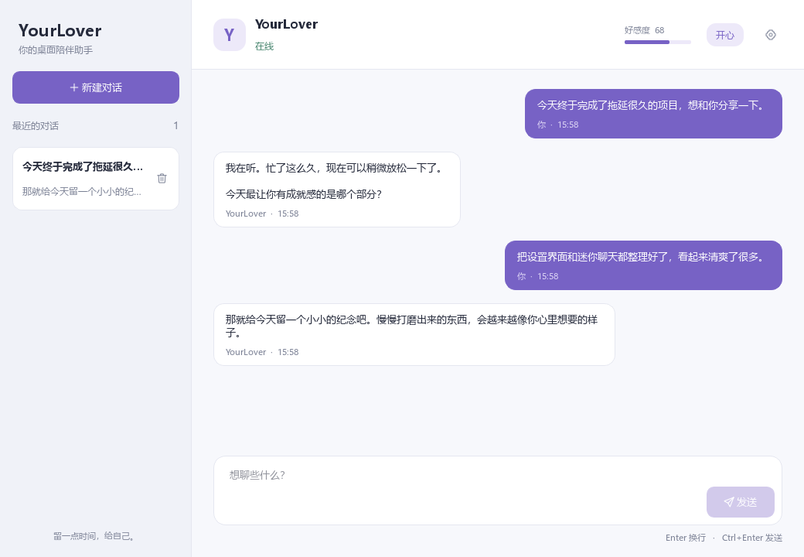
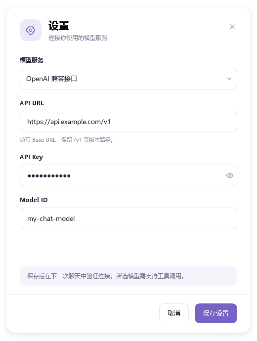
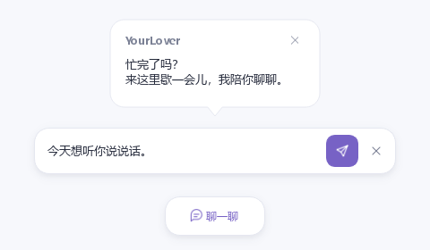

# 代码清理与桌面界面调整

本轮围绕现有功能整理代码和界面，保留 Ollama/OpenAI 兼容接口、记忆、画像、好感度、主动对话及 Live2D 交互的业务流程和存储格式。

## 代码清理

- 删除未接入的语音、音量、外观选择、流式回复和工具状态展示入口。
- 删除空托盘模块、空日志模块、未使用的角色状态枚举与无效情绪分析节点。
- 删除只返回固定结果的网页搜索、测试工具和重复实验脚本，保留真实计算器及有回归覆盖的记忆演示。
- 使用原生 QMenu 代替多层菜单构建器，设置行直接使用 QObject 信号，去掉通用扩展项中间层。
- 合并重复的聊天执行和线程启动代码，清理重复 Live2D 绘制方法、无消费者事件、无效接口与冗长重复注释。
- 工具封装直接保留函数签名、参数类型、描述和默认值，删除动态拼接并执行 Python 源码的步骤。
- 统一导入和格式，加入 Ruff 配置；运行日志使用标准 logging，远程错误保持受控提示。
- 退出时停止主动调度并等待已有工作线程完成；设置热加载继续等待活跃请求结束。

抽象接口、失败降级和模型消息协议要求的内部补充消息均有实际用途，保留这些实现。

## 界面调整

| 界面 | 调整 |
| --- | --- |
| 主聊天 | 统一品牌侧栏、清晰会话层级、空状态、可复制消息卡片、实际状态和好感度、独立多行输入区 |
| 迷你聊天 | 紧凑胶囊入口、展开输入栏、发送防重复、思考提示、可滚动长回复、悬停暂停隐藏、屏幕边界限制 |
| 设置 | 卡片式表单、按服务展示字段、密码遮罩与查看按钮、保存/取消、关闭后恢复草稿 |
| 公共组件 | 浅色与紫色主题、统一字体间距、本地 SVG 图标、高 DPI 图像、轻阴影、键盘焦点和无障碍名称 |

### 界面预览

以下是实际 Qt 控件的离屏截图，使用演示对话和演示连接信息。

主聊天：

设置：

迷你聊天的回复卡片、输入栏和收起入口：

## 验证

自动回归覆盖记忆、画像、好感度、主动消息、两种模型服务、设置保存与热加载，并补充工具 schema、文件读写、发送快捷键、忙碌状态、会话切换、多轮回复、长文本滚动及退出线程回收测试。

界面使用 Qt offscreen 截图检查空状态、多轮消息、最小尺寸、两种服务表单、迷你输入和长回复。该验证不发送真实模型请求；Live2D 的实际 OpenGL 渲染仍需在桌面运行应用验收。

本轮在 Mypy 环境验证结果：156 项自动测试通过；Ruff 静态检查和格式检查通过；完整 App 初始化、真实 QThread 回收与退出事件路由通过。未执行真实模型请求或桌面 OpenGL 渲染验收。
